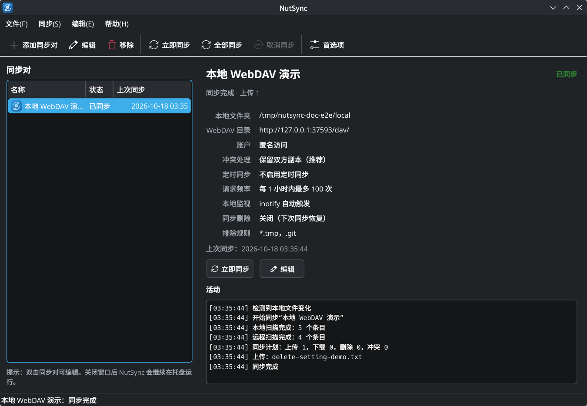

# NutSync

[English](README.md) · **简体中文**

[](https://github.com/gomodb/nutsync/actions/workflows/ci.yml)

适用于 Linux / KDE Plasma 的 **WebDAV 双向同步**桌面应用，使用 Qt 6 与 KDE Frameworks 构建。



NutSync 的目标不是做一次性的“上传/下载”，而是维护一条可靠的三路同步基线：

1. 本地目录；
2. 远程 WebDAV 目录；
3. 上一次成功同步后记录的逐条状态。

每次同步都分别判断两侧相对基线是否变化，再决定上传、下载、删除或进入冲突处理。远程协议通过 `RemoteBackend` 接口隔离，因此后续可以在不改动同步引擎的前提下增加其他协议，或接入 Rust 实现的库。

## 功能

- **双向同步**：本地与 WebDAV 各自的修改都会传播到另一侧。
- **删除同步**：每个同步对可配置“同步删除”，默认关闭。
  - 开启后，本地删除会传播到远程；
  - 关闭时，本地删除只影响本地副本，远程文件保留，并在随后一次同步中从远程恢复；
  - 远程删除始终会传播到本地；
  - 目录删除只会在“整棵子树均未发生新修改”时执行，包含排除项或冲突的目录会跳过递归删除，避免误删。
- **冲突保护**：默认 `KeepBoth`，将远程版本保存为 `name.conflict-YYYYMMDD-HHMMSS.ext`，同时把本地版本上传回去，两侧最终都保留两个版本。
  - 其他策略：本地优先、远程优先、较新者优先。
- **首次同步智能去重**：两侧都存在同名文件时会先按 SHA-256 比较，内容相同则只建立基线，不制造冲突副本。
- **安全停止条件**：
  - 本地目录不可读时不会继续同步；
  - 远程根目录不存在且已有同步基线时直接停止，不会把本地文件当作“远程已删除”；
  - 新建同步对且远程根目录不存在时会自动 `MKCOL` 创建；
  - 上传/删除使用 `If-Match` / `If-None-Match` 条件请求，尽量防止覆盖并发修改；
  - 同步过程中本地文件再次变化时，该项操作会被跳过并在下次重试。
- **排除规则**：支持 `.git`、`node_modules`、`*.tmp`、`缓存/` 等模式。被排除的远程内容会阻止对其父目录的递归删除，也不会被 inotify 监视。
- **KDE 集成**：KStatusNotifierItem 托盘、KNotification 桌面通知、KWallet / Secret Service 密码存储、可选的用户级开机自启。
- **多语言**：界面支持英文和简体中文；默认跟随系统语言，中文系统使用简体中文，其他或无法匹配的语言回退英文。可在首选项中覆盖，重启后生效。
- **单色面板图标**：系统托盘使用单色 NutSync 图标，并按 KDE 深色/浅色配色方案自动切换，支持运行中切换主题。
- **自动同步**：按同步对设置定时同步间隔、程序启动时同步，并通过 Linux inotify 递归监视本地目录；本地文件发生变化后经防抖自动触发同步。
- **请求频率限制**：可按同步对配置“每 x 分钟/小时内最多启动 y 次同步”，默认不限制。定时同步、inotify 触发和启动同步受限制；手动同步始终允许，但会占用额度。限制记录持久化，重启不会重置额度。
- **凭据安全**：配置文件不保存密码；密码写入系统钥匙串。
- **单实例**：通过锁文件避免两个实例同时写状态数据库。

## 构建

依赖：

- CMake ≥ 3.21、Ninja、C++20 编译器
- Qt 6.4+：Core、Gui、Widgets、Network、Sql（SQLite 驱动）、Concurrent、Test、LinguistTools，以及 SVG 图标插件（`qt6-svg` / `libqt6svg6`）
- 可选：QtKeychain（密码保存）
- 可选：KStatusNotifierItem、KNotifications（KDE 原生托盘与通知）

Arch Linux：

```bash
sudo pacman -S --needed base-devel cmake ninja qt6-base qt6-tools qtkeychain-qt6 \
    kstatusnotifieritem knotifications qt6-svg qt6-translations
```

Debian / Ubuntu（包名可能因发行版版本略有差异）：

```bash
sudo apt install build-essential cmake ninja-build qt6-base-dev \
    qt6-tools-dev qt6-tools-dev-tools libqt6sql6-sqlite qtkeychain-qt6-dev \
    libkf6statusnotifieritem-dev libkf6notifications-dev libqt6svg6 \
    qt6-translations-l10n
```

测试套件会启动一个本地 Python 3 WebDAV 测试服务器，请确保系统中可用 `python3`。

构建与测试：

```bash
cmake -S . -B build -G Ninja -DCMAKE_BUILD_TYPE=Release
cmake --build build
ctest --test-dir build --output-on-failure
```

运行：

```bash
./build/nutsync
```

安装：

```bash
sudo cmake --install build
```

安装后会提供 `nutsync` 可执行文件、桌面入口、AppStream 元数据与图标。

## 使用

点击“添加同步对”，填写：

- **本地文件夹**：需要同步的本地目录。
- **WebDAV 地址**：同步根目录的完整 URL，例如：
  - Nextcloud：`https://cloud.example.com/remote.php/dav/files/<用户名>/<目录>/`
  - ownCloud：`https://cloud.example.com/remote.php/webdav/<目录>/`
  - 通用 WebDAV：`https://dav.example.com/sync/`
- **用户名 / 密码**：建议为应用生成专用密码。启用两步验证的 Nextcloud/ownCloud 用户通常需要使用“应用密码”。
- **冲突处理**：一般建议保留默认的“保留双方副本”。
- **同步删除**：默认关闭。关闭时本地删除不会删除远程文件，下一次同步会从远程恢复；远程删除仍会同步到本地。
- **定时同步间隔**：`0` 表示不启用定时同步；仍可通过 inotify、启动同步或手动触发。
- **监视本地文件变化**：默认启用，通过 inotify 递归监视本地目录并在变化后自动同步。
- **请求频率上限**：默认关闭。启用后填写例如“在 1 小时内最多 10 次同步”。
- **排除规则**：每行一个，例如：

```text
.git
node_modules
*.tmp
.cache/
```

保存前可使用“测试连接”验证地址和凭据。保存后按 F5 或点击“立即同步”开始首次同步。

首次同步时：

- 只有本地存在的条目会上传；
- 只有远程存在的条目会下载；
- 两侧都存在且内容不同的同名文件会产生冲突副本；
- 内容相同的文件只建立同步基线。

## Arch Linux / AUR

AUR 元数据位于 [packaging/arch/PKGBUILD](packaging/arch/PKGBUILD)。由于 `makepkg` 会占用工作目录下的 `src/` 和 `pkg/`，这些文件放在独立子目录中。

包源码直接取自 GitHub tag：

```text
https://github.com/gomodb/nutsync/archive/refs/tags/v0.3.0.tar.gz
```

从项目内构建：

```bash
cd packaging/arch
makepkg -si
```

只构建不安装：

```bash
makepkg -f
```

AUR 仓库单独保存 PKGBUILD、`.SRCINFO` 和 0BSD 打包许可证。应用源码继续使用 GPL-3.0-or-later，AUR 打包文件使用 0BSD。

AUR 本版本发布为 `0.3.0-1`。发布新版本时更新 `pkgver`、`source` 和 `sha256sums`，再执行：

```bash
makepkg --printsrcinfo > .SRCINFO
```

## 配置与数据位置

遵循 XDG 目录规范：

| 内容 | 路径 |
| --- | --- |
| 配置 | `~/.config/nutsync/config.json` |
| 同步状态数据库 | `~/.local/share/nutsync/state.db` |
| 日志 | `~/.local/share/nutsync/nutsync.log` |
| 请求频率记录 | `~/.local/share/nutsync/rate_limits.json` |
| 开机自启条目 | `~/.config/autostart/io.github.nutsync.NutSync.desktop` |
| 临时冲突下载 | `~/.cache/nutsync/` |
| 密码 | KWallet / Secret Service（service id `io.github.nutsync.NutSync`） |

状态数据库使用 SQLite，按同步对 ID 隔离。同步对位置改变时，程序会要求清空该同步对的基线（不会删除任何文件）。也可以从右键菜单或“编辑”菜单选择“清空同步基线…”来重置单个同步对。

## 设计

```text
src/core/
  remote_backend.h       协议无关的远程后端接口
  webdav_backend.*       WebDAV/HTTP 实现（PROPFIND/GET/PUT/MKCOL/DELETE）
  sync_planner.*         纯函数式三路比较与操作计划
  sync_engine.*          扫描、计划执行、冲突处理、状态更新
  local_change_monitor.* Linux inotify 递归监视与防抖
  sync_rate_limiter.*    持久化的同步启动频率限制
  sync_state_store.*     SQLite 基线状态
  config_store.*         JSON 配置
  credential_store.*     QtKeychain 封装
src/ui/
  main_window.*          主窗口、托盘、调度
  pair_dialog.*          同步对编辑与连接测试
  sync_controller.*      后台线程队列
  tray_controller.*      KStatusNotifierItem / QSystemTrayIcon
```

同步计划只依赖三份快照（本地、远程、基线），因此可以独立进行单元测试。引擎在后台线程执行，GUI 通过信号接收进度与日志。

### WebDAV 细节

- 递归扫描通过逐目录 `PROPFIND Depth: 1` 完成，兼容不允许 `Depth: infinity` 的服务器。
- 下载使用 `GET` 并原子写入；上传使用 `PUT`，包含 `Content-Length`。
- ETag、Last-Modified、Content-Length 被用于基线判断。
- 支持 Basic 认证；建议使用 HTTPS。
- 不忽略 TLS 证书错误。

## 代码格式

项目根目录的 [.clang-format](.clang-format) 以 Clang 的 WebKit 风格为基础，并结合 Qt/KDE 常见约定做了项目化配置：

- 4 空格缩进、100 列；
- 函数、类、结构体、枚举和命名空间的大括号独立成行，控制流和 lambda 使用同行大括号；
- 指针和引用符号靠近变量名，例如 `QString *value`、`const QString &value`；
- 保留手工维护的 include 分组，不自动排序或重排注释；
- C++20。

格式化 `src/` 和 `tests/`：

```bash
find src tests -type f \( -name '*.cpp' -o -name '*.h' \) -print0 \
    | xargs -0 clang-format -i
```

配置参考：

- [Clang-Format Style Options](https://clang.llvm.org/docs/ClangFormatStyleOptions.html)
- [Qt Coding Style](https://wiki.qt.io/Qt_Coding_Style)
- [KDE Frameworks Coding Style](https://community.kde.org/Policies/Frameworks_Coding_Style)

## 语言

界面语言默认跟随系统设置：

- 中文系统使用简体中文；
- 其他或无法匹配的语言使用英文。

可在“首选项 → 界面语言”中选择“跟随系统”“English”或“简体中文”。更改后需要重启 NutSync 才能生效。

## 首选项

“首选项”中可以配置桌面通知、关闭到托盘、启动时同步、开机自启等全局选项。开机自启使用标准的 XDG autostart 条目，写入当前用户的配置目录，并通过 `--hidden` 参数启动 NutSync：

```text
~/.config/autostart/io.github.nutsync.NutSync.desktop
```

该选项默认不勾选。勾选后将在下次登录时生效；取消勾选会删除对应条目。

## 测试

测试覆盖：

- 路径规范化、排除规则、URL 编码、HTTP 日期解析；
- 三路同步计划：新增、修改、删除、目录递归删除、类型冲突、冲突检测；
- 删除策略：本地删除传播开关、关闭时从远程恢复、远程删除仍传播、冲突策略下的删除保护；
- 完整同步引擎（内存远程后端）：双向传播、删除、空目录、冲突副本、排除保护、远程根目录缺失保护；
- inotify 监视：文件变化、排除规则、同步期间抑制、新目录与重命名目录的递归监视；
- 请求频率限制：窗口计算、额度耗尽、手动同步占用额度、持久化与清除；
- 开机自启：默认无条目、创建 XDG autostart 文件、内容校验与删除；
- 真实 HTTP WebDAV 集成：使用 `tests/mock_webdav_server.py` 启动本地服务器，验证 Basic 认证、Unicode/空格路径、扫描、下载、上传、条件请求与删除。

```bash
ctest --test-dir build --output-on-failure
```

## 已知限制

- 冲突策略中的“文件 vs 目录”类型冲突不会自动破坏性解决，会报告错误并要求手动处理。
- 符号链接和特殊文件会被跳过；指向它们的目录删除也会被阻止。
- 目录删除的并发保护取决于服务器是否正确执行 `If-Match`；最终一致性由下一次同步修正。
- inotify 监视仅在 Linux 上可用；受系统 `max_user_watches` 限制，目录极多时可能只能监视部分子树，界面会显示监视错误并继续使用定时同步。
- 同步执行期间以及结束后的约 2 秒内，本地监视会抑制触发，避免把 NutSync 自己的下载/删除当作本地修改；这段时间内的用户修改会在下一次定时/手动同步时处理。
- “同步删除”关闭时，本地删除会在随后一次同步中恢复；如果启用了 inotify，这个恢复可能会很快发生。要永久删除本地和远程文件，请开启“同步删除”。
- 上传/下载目前顺序执行；大目录或高延迟服务器上首次同步会比较慢。
- 不支持 OAuth2 / Digest 挑战式认证；Nextcloud 应用密码配合 Basic 认证可用。
- 请求频率限制约束的是“同步启动次数”，不是单次同步内部的每一条 HTTP 请求。
- 不提供端到端加密；请使用 HTTPS 和可信服务器。

## 参考

- [celeste](https://github.com/hwittenborn/celeste)：以 rclone 为后端的 GTK 双向同步客户端，本项目借鉴了其“多后端 + 冲突保护”的产品思路，但同步引擎、状态模型和界面均为独立实现。

## 许可证

GPL-3.0-or-later，见 [LICENSE](LICENSE)。
